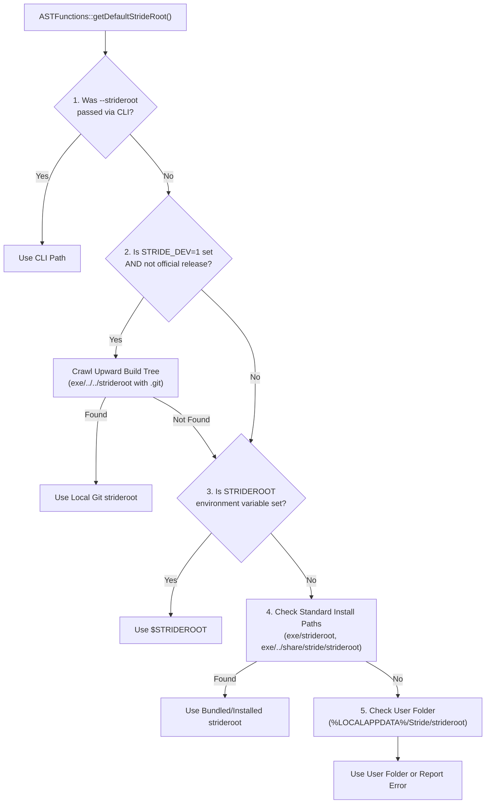

# Stride Toolchain Developer Workflow

This guide explains how to develop, test, and debug the Stride compiler, runtime tools, and standard library locally while coexisting seamlessly with an officially installed release of Stride on the same machine.

---

## 1. Overview: The Dual-Environment Challenge

In a typical developer setup, you may have:
1. **An Installed Release**: Installed via the official Windows NSIS installer or system package into `C:\Program Files\Stride` (or `/usr/local`). This sets system-wide `PATH` and `STRIDEROOT` environment variables for general use across the OS.
2. **A Development Checkout**: Your active Git worktree (e.g. `C:\Users\...\source\repos\Stride` or `boardgame/libgame/external/stridelang`), where you are compiling bleeding-edge compiler changes, adding standard library modules, or tuning JIT optimizations.

Without proper isolation, running a locally built binary might inadvertently load the *installed* standard library from the system registry, or a global shell command might invoke the wrong binary. Stride solves this with **compile-time gating**, **developer opt-in**, and **workspace isolation**.

---

## 2. Library Discovery Precedence (`findStrideRoot`)

When any Stride executable (`stride`, `stridec`, `stridetest`, `stride-lsp`) initializes, it discovers `STRIDEROOT` using this strict hierarchy:



---

## 3. Developer Mode: `STRIDE_DEV`

To allow locally built binaries to find your git worktree's `strideroot` automatically—without getting shadowed by the global `STRIDEROOT` in the Windows registry—set the `STRIDE_DEV` environment variable:

```powershell
$env:STRIDE_DEV = 1
```

### How `STRIDE_DEV` Works:
1. When `STRIDE_DEV=1` is active in your terminal, [`ASTFunctions::getDefaultStrideRoot()`](file:///c:/Users/Andres/source/repos/boardgame/libgame/external/strideutils/src/astfunctions.cpp) prioritizes local git repositories adjacent to the binary (`exe/../strideroot`, `exe/../../strideroot`, etc.) over the system registry's `STRIDEROOT`.
2. **Git Worktree Verification**: It automatically verifies that the candidate path contains a genuine `.git` repository marker ([`isDevelopmentGitWorktree()`](file:///c:/Users/Andres/source/repos/boardgame/libgame/external/strideutils/src/astfunctions.cpp)). Arbitrary directories named `strideroot` are ignored.
3. **Compile-Time Security Gate**: In official production builds (`-DSTRIDE_OFFICIAL_RELEASE=ON`), this discovery logic is **completely compiled out**. Shipped release installers will never crawl parent directories, eliminating path-hijacking vulnerabilities in production.

---

## 4. Terminal Workflows

### PowerShell Setup (Windows)
Add these helper functions to your PowerShell profile (`notepad $PROFILE`):

```powershell
function use-stride-dev {
    $devRoot = "C:\Users\Andres\source\repos\Stride"
    $env:STRIDE_DEV = "1"
    $env:STRIDEROOT = "$devRoot\strideroot"
    $env:PATH = "$devRoot\build\bin;$env:PATH"
    Write-Host "Switched to Dev Stride Toolchain:" -ForegroundColor Cyan
    Write-Host "  Binary:     $devRoot\build\bin\stride.exe"
    Write-Host "  STRIDEROOT: $env:STRIDEROOT"
}

function use-stride-release {
    $env:STRIDE_DEV = $null
    $env:STRIDEROOT = $null  # Reverts to Windows registry default
    Write-Host "Reverted to Installed Release Stride." -ForegroundColor Green
}
```

Now, typing `use-stride-dev` in any terminal configures the session for development. Running `use-stride-release` or opening a fresh shell restores the installed release.

### Bash / Zsh Setup (Linux / macOS)
Add to your `~/.bashrc` or `~/.zshrc`:

```bash
use-stride-dev() {
    export STRIDE_DEV=1
    export STRIDEROOT="$HOME/source/repos/Stride/strideroot"
    export PATH="$HOME/source/repos/Stride/build/bin:$PATH"
    echo "Switched to Stride Dev Toolchain ($STRIDEROOT)"
}

use-stride-release() {
    unset STRIDE_DEV
    unset STRIDEROOT
    echo "Reverted to Installed Stride."
}
```

---

## 5. Visual Studio Code Workspace Configuration

If you develop on Stride or Stride-based games using VS Code, you can pin development workspaces to your local builds while leaving the rest of your machine on the official release.

In your development project's `.vscode/settings.json`:

```json
{
    "stride.strideroot": "${workspaceFolder}/strideroot",
    "stride.stridecPath": "${workspaceFolder}/build/bin/stridec.exe",
    "stride.server.path": "${workspaceFolder}/build/bin/stride-lsp.exe"
}
```

* **When working in this workspace**: VS Code uses your freshly compiled compiler, language server, and local standard library.
* **When opening any other folder**: VS Code falls back to the globally installed Stride release.

---

## 6. Verifying the Active Environment: `stride doctor`

Whenever you need to confirm which compiler binary and standard library are currently active, run the built-in diagnostic tool:

```powershell
stride doctor
```

Example diagnostic output:

```text
=== Stride Doctor Diagnostic Check ===

[1/4] Checking STRIDEROOT...
  [OK] STRIDEROOT: C:\Users\Andres\source\repos\Stride\strideroot
  [OK] Standard library folder found.
  [OK] Systems folder found.

[2/4] Checking PATH environment...
  [OK] System PATH is accessible.

[3/4] Checking Host C++ Compiler / Toolchain...
  [OK] Clang LLVM compiler detected in PATH.

[4/4] Checking VS Code CLI...
  [OK] Visual Studio Code CLI ('code') is installed and in PATH.

Doctor check completed.
```

If `STRIDEROOT` points to your development checkout, your development environment is correctly active.

---

## 7. Testing Local Changes

Before committing changes, run the test suites locally using `ctest`:

```powershell
# Build the toolchain and tests in Debug mode
cmake --build build --config Debug

# Run the test suite
ctest --test-dir build --output-on-failure
```
