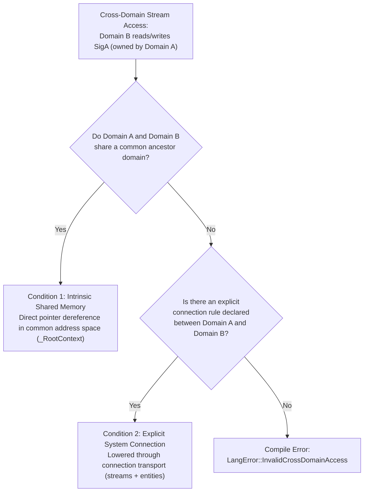

# Multi-Domain Computation, Shared Memory & System Connections

Stride programs are designed to span diverse execution environments — from single-threaded DSP pipelines and multi-threaded desktop applications to heterogeneous multi-core microcontrollers (e.g. Raspberry Pi RP2350 with ARM Cortex-M33 and RISC-V Hazard3 cores) and distributed network systems.

This document specifies the **multi-domain execution model**, **memory hierarchy**, **parameterized connection blueprints**, and **symmetrical native platform entities** that govern cross-domain computation in Stride.

---

## 1. Architectural Taxonomy: Systems, Frameworks, Platforms & Domains

To decouple dataflow algorithms from target hardware and toolchains, Stride defines four foundational layers:

| Entity | Role | Definition | Examples |
| :--- | :--- | :--- | :--- |
| **Platform** | **Hardware Support** | Hardware topology, device pinouts, peripherals, registers, memory layouts (SRAM, Flash, TCM, zpads), DMA controllers, interrupt vectors. | `RP2040`, `RP2350`, `STM32F4`, `Local_x86_64` |
| **Framework** | **Toolchain & Runtime** | Target compiler backend, code emission strategy, platform modules, operator lowering implementations, runtime library bindings. | `JIT`, `Cpp`, `RtAudio`, `Wiring`, `PicoSDK` |
| **System** | **Deployment Topology** | Groups platforms and frameworks into a deployable application; declares abstract **Connections** bridging disjoint targets. | `DesktopApp`, `DesktopAudioApp` |
| **Domain** | **Computation Group** | Execution context for signals, streams, and state machines; **always tied to a Framework**; requires and provides **Resources**. | `AudioDomain`, `ControlDomain`, `RootDomain` |

```mermaid
flowchart TD
    subgraph System ["System: DesktopAudioApp (Deployment Topology)"]
        direction TB

        subgraph PlatformPC ["Platform: PC Desktop (Hardware)"]
            FrameworkJIT ["Framework: JIT / Cpp (Toolchain)"]
            FrameworkJIT --> DomAudio ["Domain: AudioDomain (Real-Time Audio)"]
            FrameworkJIT --> DomControl ["Domain: ControlDomain (Asynchronous UI/Events)"]
        end

        subgraph PlatformMCU ["Platform: RP2350 / STM32 (Hardware)"]
            FrameworkMCU ["Framework: PicoSDK / BareMetal (Toolchain)"]
            FrameworkMCU --> DomDSP ["Domain: DspDomain (Cortex-M33)"]
            FrameworkMCU --> DomIO ["Domain: IoDomain (Hazard3 RISC-V)"]
        end

        DomControl -.->|"Connection (Serial / Protobuf)"| DomDSP
        DomDSP -.->|"Connection (Shared SRAM / DMA / zpad)"| DomIO
    end
```

---

## 2. Domains: Definition & Compilation Model

### 2.1 Unified Domain Model
A domain (`_domainDefinition`) defines a discrete execution boundary. Its internal dataflow streams, state machines, and reactions are completely backend-agnostic. The domain's **`framework`** property selects the compilation engine:

- When `framework: _JitFramework`, the domain compiles directly into in-memory LLVM IR functions.
- When `framework: _CppFramework` or embedded toolchains (e.g. `_PicoSDKFramework`), the domain compiles through Ahead-Of-Time (AOT) C++ template emission or native object compilation via `stridec`.

```stride
_domainDefinition AudioDomain {
    framework: _JitFramework
    rate: 48000
}

_domainDefinition ControlDomain {
    framework: _JitFramework
    rate: 1000
    parentDomain: AudioDomain
}
```

### 2.2 Domain Lifecycle Functions
Every compiled domain provides a standardized four-phase lifecycle API:

| Phase | Generated C API | Responsibilities |
| :--- | :--- | :--- |
| **Load** | `<Domain>_load()` | Evaluates **`onLoad`** streams outside any instance. Prepares read-only tables and precomputed constants. Guarded by an atomic compare-and-swap (CAS). |
| **Init** | `<Domain>_init(void *state)` | Evaluates **`onInit`** streams, resets signals and switches owned by this domain to default values, and resets state machines. |
| **Process** | `<Domain>_process(...)` | Evaluates the domain's stream pipelines, active state machine transitions/actions, and triggered reactions for one execution tick. |
| **Cleanup** | `<Domain>_cleanup(void *state)` | Releases acquired hardware/software resources, stops worker threads, joins background tasks. |

---

## 3. Signal Ownership & Cross-Domain Access Rules

### 3.1 Signal Ownership
Every signal declared with `domain: <DomainName>` is **owned** by that domain:
```stride
signal SensorValue {
    type: Real
    default: 0.0
    domain: SensorDomain
}
```
The owning domain manages initialization during `<Domain>_init` and evaluates state mutations/resets during `<Domain>_process`.

### 3.2 Cross-Domain Validity Conditions
When Domain B reads or writes a signal owned by Domain A ($A \neq B$), the compiler validates that the boundary satisfies at least one of two conditions:



If neither condition is met, `CodeValidator` rejects the stream at compile time:
> `Error: Signal 'SigA' owned by domain 'DomainA' cannot be accessed from domain 'DomainB': domains do not share a common parent domain or connection`

---

## 4. Mode 1: Intrinsic Shared Memory (Common Parent Domain)

When two domains share a common ancestor domain (`commonAncestor(DomainA, DomainB) != none`), they reside within the same parent memory context (`_RootContext`).

### Example: Produce-Consume over Shared Memory
```stride
_domainDefinition RootDomain {
    framework: _JitFramework
}

_domainDefinition ProduceDomain {
    framework: _JitFramework
    parentDomain: RootDomain
}

_domainDefinition ConsumeDomain {
    framework: _JitFramework
    parentDomain: RootDomain
}

signal ProduceVal {
    type: Int
    default: 10
    domain: ProduceDomain
}

signal ConsumeVal {
    type: Int
    default: 0
    domain: ConsumeDomain
}

# Producer updates its owned signal
ProduceVal + 1 >> ProduceVal;

# Consumer directly reads ProduceVal from shared memory
ProduceVal + 5 >> ConsumeVal;
```

### Compiler Lowering Invariants:
1. **Shared Signal Storage**: Signals belonging to domains with an ancestor relationship reside in global module memory rather than being hidden inside a domain's private dynamic stack/state struct.
2. **Consumer-Attributed Reads**: The cross-domain assignment `ProduceVal + 5 >> ConsumeVal` is attributed to `ConsumeDomain_process`, which loads `ProduceVal` directly from shared memory.
3. **Initialization Ownership**: `ProduceDomain_init` retains sole responsibility for resetting `ProduceVal` to its declared default (10).

---

## 5. Mode 2: Parameterized Connection Blueprints

When domains do not share a common memory resource (e.g., across physical MCU cores, hardware peripherals, or network boundaries), communication requires an explicit **`connection`**.

### 5.1 Connection Blueprints (`strideroot/systems/<System>/<Ver>/System.stride`)
System repositories declare generic connection blueprints containing default parameters and driver streams:

```stride
connection _PCToWiringSerial {
    port: 0
    baudRate: 115200

    sourceFramework: _PCPlatform
    sourceDomains: [ "DesktopDomain" ]
    destinationFramework: _WiringPlatform
    destinationDomains: [ "WiringDomain" ]

    sourceImports: [ "Serial" ]
    sourceStreams: [
        _Connection_Token >> SerialOut[.port];
    ]

    destinationImports: [ "Serial" ]
    destinationStreams: [
        Wiring::SerialIn[.port] >> _Connection_Token;
    ]
}
```

### 5.2 Project Specialization & Overrides
User applications specialize parameters without modifying system blueprint files:

- **System Connection Block**:
  ```stride
  system DesktopApp {
      platforms: [ _WiringPlatform, _PCPlatform ]
      connections: [
          connection _PCToWiringSerial {
              port: 1
              baudRate: 57600
          }
      ]
  }
  ```

- **Invocation / Call Syntax**:
  ```stride
  system DesktopApp {
      platforms: [ _WiringPlatform, _PCPlatform ]
      connections: [
          _PCToWiringSerial(port: 1 baudRate: 57600)
      ]
  }
  ```

- **Default Inheritance**: Listing a connection without overrides (`connections: [ _PCToWiringSerial ]`) inherits all blueprint defaults (`port: 0`, `baudRate: 115200`).

### 5.3 AST Property Substitution & Stream Splicing
During lowering (`StrideSystem::generateDomainConnections`):
1. **Effective Property Merging**: Blueprint defaults are merged with project overrides.
2. **Recursive AST Substitution**: Occurrences of connection properties (e.g. `.port`) inside streams and entities are replaced with concrete literal values (e.g. replacing `SerialOut[.port]` with `SerialOut[1]`).
3. **Splicing**: Cross-domain streams `SigA >> SigB;` are automatically split across the boundary:
   - `SigA >> SerialOut[1];` (executed in source domain)
   - `Wiring::SerialIn[1] >> SigB;` (executed in destination domain)

---

## 6. Symmetrical Native Entities in Connections (`sourceEntities` & `destinationEntities`)

Connections often require hardware glue logic, register writes, or platform-specific driver modules. To support **heterogeneous compilation targets** (e.g. in-memory LLVM IR JIT on host PC $\longleftrightarrow$ C++ source text generation on an embedded MCU) without requiring external dummy packages, `connection` provides symmetrical entity lists:

```stride
connection _PCToPicoUart {
    baudRate: 115200
    port: 0

    sourceFramework: _JitFramework
    sourceDomains: [ "DesktopDomain" ]
    destinationFramework: _PicoSDKFramework
    destinationDomains: [ "McuDomain" ]

    # Native entities compiled for the source framework (LLVM IR on host PC)
    sourceEntities: [
        constant HostPort { value: .port }
        platformModule NativeHostUartSend {
            inputs: [ Int ]
            outputs: []
            processing: "%%outtokens:0%% = llvm::call void @host_uart_write(i32 %%intokens:0%%)"
        }
    ]

    # Native entities compiled for the destination framework (C++ text codegen on RP2040)
    destinationEntities: [
        constant McuPort { value: .port }
        platformModule NativeMcuUartRecv {
            inputs: []
            outputs: [ Int ]
            processing: "uart_read_blocking(uart_default, (uint8_t*)&%%outtokens:0%%, 1);"
        }
    ]

    # Bridging streams connecting to _Connection_Token
    sourceStreams: [
        _Connection_Token >> NativeHostUartSend();
    ]

    destinationStreams: [
        NativeMcuUartRecv() >> _Connection_Token;
    ]
}
```

### Invariants:
1. **Unambiguous Target Assignment**:
   - Entities in `sourceEntities: [...]` belong strictly to `sourceFramework` and are compiled exclusively by the source domain's toolchain.
   - Entities in `destinationEntities: [...]` belong strictly to `destinationFramework` and are compiled exclusively by the destination domain's toolchain.
2. **PlatformModule Invocation**:
   - `platformModule` represents a native function that strictly accepts main inputs (`inputs: [...]`) and produces main outputs (`outputs: [...]`). It does not take property ports.
   - Connection parameters (e.g. `.port`) parameterize constants (`constant HostPort { value: .port }`) or substituted templates.
3. **Automated AST Splicing**:
   - `StrideSystem::generateDomainConnections` sets the appropriate `"domain"` and `"framework"` properties on each entity and splices them into the compilation AST, allowing downstream builders (`stridejit` or `stridec`) to compile them transparently.
