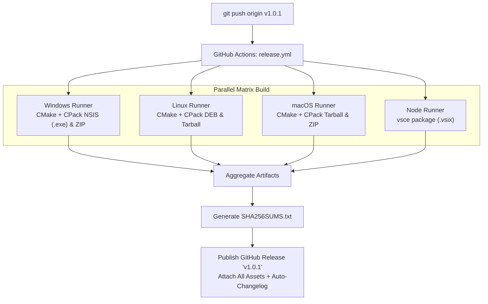

# Stride Toolchain Release Procedure

This document outlines the versioning scheme, CI/CD pipeline, and step-by-step procedure for releasing new versions of the Stride CLI toolchain, compiler drivers, cross-platform installers, and VS Code extension.

---

## 1. Overview & Architecture

Releases are fully **Git- and CI-driven** via GitHub Actions:
- **`ci.yml` (Continuous Integration)**: Automatically triggered on every `push` and `pull_request` to `main`, `master`, or `develop`. Compiles `stride` and `stridec`, runs unit tests via `ctest`, and tests CPack packaging across Linux, Windows, and macOS.
- **`release.yml` (Release Packaging & Deployment)**: Automatically triggered whenever a version tag matching `v*` (e.g. `v1.0.1`) is pushed. Builds native installers, bundles `strideroot` and the VS Code extension, computes SHA256 checksums, and publishes an official GitHub Release.

### Deliverables Produced per Release:
1. **Windows**:
   - NSIS Setup Installer (`stridelang-<version>-win64.exe`):
     - Installs `stride.exe` and `stridec.exe` to `$INSTDIR\bin`.
     - Automatically adds `$INSTDIR\bin` to system `PATH`.
     - Sets the `STRIDEROOT` environment variable in the Windows registry pointing to `$INSTDIR\strideroot` and broadcasts `WM_SETTINGCHANGE`.
     - Probes for VS Code CLI (`code.cmd` / `code.exe`) and runs `code --install-extension "$INSTDIR\vscode\stride-language.vsix" --force`.
   - Portable Zip archive (`stridelang-<version>-win64.zip`).
2. **Linux**:
   - Debian package (`stridelang_<version>_amd64.deb`).
   - Tarball archive (`stridelang-<version>-Linux.tar.gz`).
3. **macOS**:
   - Tarball archive (`stridelang-<version>-Darwin.tar.gz`).
   - Portable Zip archive (`stridelang-<version>-Darwin.zip`).
4. **Editor**:
   - Visual Studio Code Extension package (`stride-language.vsix`).
5. **Integrity**:
   - `SHA256SUMS.txt` cryptographic manifest covering all release assets.

---

## 2. Release Steps (Maintainer Workflow)

Releasing a new version requires only four simple steps:

### Step 1: Bump Version Number in `CMakeLists.txt`
In `CMakeLists.txt`, update the `project` version:
```cmake
project(stridelang VERSION 1.0.1 LANGUAGES C CXX)
```
*(If applicable, ensure the version string in `package.json` in `vscode-stride-lang` matches).*

### Step 2: Ensure Tests Pass Locally
Verify that the test suite builds and passes cleanly:
```powershell
cmake --build build --config Debug
ctest --test-dir build --output-on-failure
```

### Step 3: Commit Version Bump
Commit your changes to `main`:
```bash
git add CMakeLists.txt
git commit -m "chore(release): bump version to 1.0.1"
git push origin main
```

### Step 4: Tag and Push
Create an annotated Git tag matching `v<version>` and push it:
```bash
git tag v1.0.1
git push origin v1.0.1
```

---

## 3. What Happens Automatically in CI

Once the `v*` tag is pushed to GitHub, [`.github/workflows/release.yml`](file:///c:/Users/Andres/source/repos/boardgame/libgame/external/stridelang/.github/workflows/release.yml) executes the following tasks in parallel:



1. **Windows Builder (`windows-latest`)**:
   - Configures Ninja + MSVC.
   - Compiles `stride` and `stridec`.
   - Runs `cpack -G "NSIS;ZIP"` to produce the Windows Installer and portable archive.
2. **Linux Builder (`ubuntu-latest`)**:
   - Configures Ninja + GCC/Clang with LLVM.
   - Compiles `stride` and `stridec`.
   - Runs `cpack -G "TGZ;DEB"` to produce `.deb` and `.tar.gz`.
3. **macOS Builder (`macos-latest`)**:
   - Compiles Universal / Apple Silicon & Intel binaries.
   - Runs `cpack -G "TGZ;ZIP"`.
4. **VS Code Extension Builder**:
   - Checks out `vscode-stride-lang`, runs `npm install`, and packages `stride-language.vsix`.
5. **Release Publisher**:
   - Downloads all artifacts from the matrix runners.
   - Computes cryptographic SHA256 hashes into `SHA256SUMS.txt`.
   - Creates the official GitHub Release with auto-generated release notes from git commits.

---

## 4. Manual / Hotfix Releases via GitHub UI

If you need to trigger a release or re-run a packaging build without creating a new tag:
1. Navigate to the repository on GitHub.
2. Go to **Actions** -> **Release Build & Cross-Platform Packaging**.
3. Click **Run workflow** -> Select the branch (e.g. `main`) -> Click **Run workflow**.

---

## 5. End-User Installation & Upgrade Verification

### On Windows (NSIS Installer)
1. Run `stridelang-<version>-win64.exe`.
2. Follow the wizard. The installer will:
   - Copy binaries and `strideroot`.
   - Add `$INSTDIR\bin` to PATH.
   - Set `STRIDEROOT` in the environment registry.
   - Detect VS Code and install `stride-language.vsix`.
3. Open a new terminal and run:
   ```powershell
   stride --version
   stride doctor
   ```
4. Verify that `STRIDEROOT` is recognized and all status items report `[OK]`.

### Upgrading Existing Projects
Users can upgrade `use <System> version <Old>` declarations within any project folder using the unified CLI:
```powershell
stride system upgrade . 1.1
```
